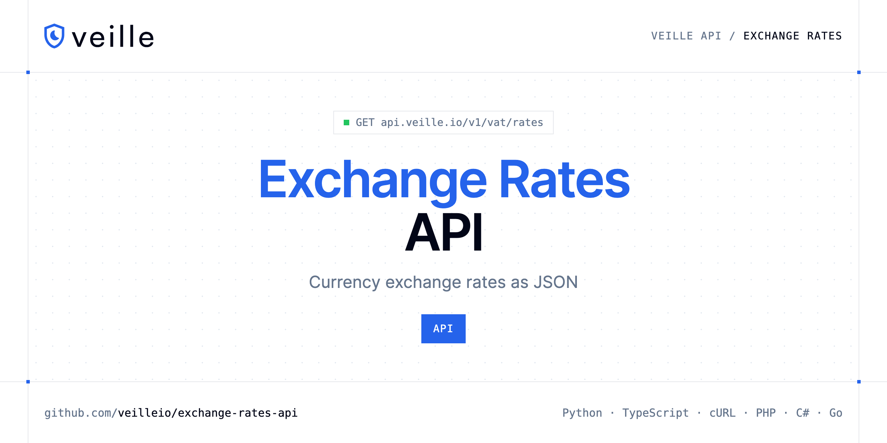

<p align="center">
  <a href="https://www.veille.io"></a>
</p>

# Exchange Rates API

[](https://discord.gg/CFj3ph8aHU) [](https://app.veille.io/register) [](https://app.veille.io/openapi) [](LICENSE)

The **Veille Exchange Rates API** returns currency exchange rates as JSON for invoicing, pricing and reporting.

- **Exchange Rates API** — Get current ECB exchange rates for any supported base currency.

Use it for multi-currency pricing, invoices and financial reports.

| Endpoint | Request | Credits |
|---|---|---|
| [Exchange Rates API](#exchange-rates-api) | `GET /v1/vat/rates` | 1 |

## Table of contents

- [How it works](#how-it-works)
- [Exchange Rates API](#exchange-rates-api)
- [Code examples in other languages](#code-examples-in-other-languages)
- [Use cases](#use-cases)
- [Why Veille?](#why-veille)
- [FAQ](#faq)
- [Official SDKs](#official-sdks)
- [Related repositories](#related-repositories)
- [Support](#support)

## How it works

1. **Create a Veille account** and copy your API key from the [dashboard](https://app.veille.io/register).
2. **Call `https://api.veille.io`** with the header `x-api-key: YOUR_API_KEY`.
3. **Use the result** in your app — no infrastructure to run.

```bash
export VEILLE_API_KEY="your-api-key"
pip install requests        # Python
# TypeScript: Node.js 18+ (native fetch), run with `npx tsx file.ts`
```

## Exchange Rates API

Get current ECB exchange rates for any supported base currency. Optionally filter to specific target currencies. Updated daily from the European Central Bank.

`GET https://api.veille.io/v1/vat/rates` · **1 credit per request** · [API reference](https://app.veille.io/openapi)

### Request parameters

| Parameter | In | Type | Required | Description |
|---|---|---|---|---|
| `base` | query | string | — | Base currency ISO 4217 code (defaults to EUR). |
| `symbols` | query | string | — | Comma-separated target currency codes to filter (e.g. USD,GBP,JPY). |

### Python example

```python
import os

import requests

API_KEY = os.environ["VEILLE_API_KEY"]
HEADERS = {"x-api-key": API_KEY}

response = requests.get(
    "https://api.veille.io/v1/vat/rates",
    headers=HEADERS,
    timeout=120,
)
response.raise_for_status()

data = response.json()
print(data)
```

### TypeScript example

```typescript
type ExchangeRatesApi = {
  base?: string;
  date?: string;
  rates?: {
    AUD?: number;
    BRL?: number;
    CAD?: number;
    CHF?: number;
    CNY?: number;
    CZK?: number;
    DKK?: number;
    EUR?: number;
    GBP?: number;
    HKD?: number;
    HUF?: number;
    IDR?: number;
    ILS?: number;
    INR?: number;
    ISK?: number;
    JPY?: number;
    KRW?: number;
    MXN?: number;
    MYR?: number;
    NOK?: number;
    NZD?: number;
    PHP?: number;
    PLN?: number;
    RON?: number;
    SEK?: number;
    [key: string]: unknown;
  };
};

const headers = { "x-api-key": process.env.VEILLE_API_KEY!, "Content-Type": "application/json" };

const response = await fetch("https://api.veille.io/v1/vat/rates", { headers });
if (!response.ok) throw new Error(`HTTP ${response.status}: ${await response.text()}`);

const data = (await response.json()) as ExchangeRatesApi;
console.log(data);
```

### Output example

Example response from the API reference, abridged.

```json
{
  "base": "EUR",
  "date": "2026-02-20",
  "rates": {
    "AUD": 1.6697,
    "BRL": 6.1358,
    "CAD": 1.6112,
    "CHF": 0.9132,
    "CNY": 8.1294,
    "CZK": 24.241,
    "DKK": 7.4716,
    "EUR": 1,
    "GBP": 0.8728,
    "HKD": 9.1961,
    "HUF": 379.65,
    "IDR": 19872.87,
    "ILS": 3.6783,
    "INR": 107.0155,
    "ISK": 144.9,
    "JPY": 182.63,
    "KRW": 1705.81,
    "MXN": 20.2402,
    "MYR": 4.5927,
    "NOK": 11.254,
    "NZD": 1.9763,
    "PHP": 68.428,
    "PLN": 4.2238,
    "RON": 5.0978,
    "SEK": 10.6745
  }
}
```

### Response fields

| Field | Type | Description |
|---|---|---|
| `base` | string |  |
| `date` | string |  |
| `rates` | object |  |
| `rates.AUD` | number |  |
| `rates.BRL` | number |  |
| `rates.CAD` | number |  |
| `rates.CHF` | number |  |
| `rates.CNY` | number |  |
| `rates.CZK` | number |  |
| `rates.DKK` | number |  |
| `rates.EUR` | integer |  |
| `rates.GBP` | number |  |
| `rates.HKD` | number |  |
| `rates.HUF` | number |  |
| `rates.IDR` | number |  |
| `rates.ILS` | number |  |
| `rates.INR` | number |  |
| `rates.ISK` | number |  |
| `rates.JPY` | number |  |
| `rates.KRW` | number |  |
| `rates.MXN` | number |  |
| `rates.MYR` | number |  |
| `rates.NOK` | number |  |
| `rates.NZD` | number |  |
| `rates.PHP` | number |  |

## Code examples in other languages

Ready-to-run examples live in [`examples/`](examples); each reads your key from `VEILLE_API_KEY`.

| Language | `vat-rates` |
|---|---|
| cURL (Bash) | [vat_rates.sh](examples/curl/vat_rates.sh) |
| PHP | [vat_rates.php](examples/php/vat_rates.php) |
| C# | [VatRates.cs](examples/csharp/VatRates.cs) |
| Go | [vat_rates.go](examples/go/vat_rates.go) |
| Java | [VatRatesExample.java](examples/java/VatRatesExample.java) |
| Ruby | [vat_rates.rb](examples/ruby/vat_rates.rb) |
| Node.js | [vat_rates.mjs](examples/nodejs/vat_rates.mjs) |

## Use cases

- **Multi-currency pricing** — Convert prices for international customers.
- **Reporting** — Normalise revenue in one currency.

## Why Veille?

- **Stop fake sign-ups** — validate emails and domains before creating accounts.
- **Block abuse** — check IP reputation to stop bots and automated attacks.
- **Clean billing data** — validate VAT numbers and IBANs, get exchange rates.
- **Fast** — designed to run inline in sign-up and checkout flows.
- **Copy-paste examples** — Python and TypeScript in each README, 7 more languages in `examples/`.

## FAQ

### How do I authenticate?

Create an account on [Veille](https://app.veille.io/register), copy your API key and send it in the `x-api-key` header of every request to `https://api.veille.io`.

### How much does a request cost?

Credits per call: `/v1/vat/rates` **1**. See [Veille pricing](https://www.veille.io/pricing).

### Which languages are supported?

Any language that can make an HTTP request. This README shows Python and TypeScript; the [`examples/`](examples) folder contains cURL, PHP, C#, Go, Java, Ruby and Node.js.

## Official SDKs

Use Veille from your own language with a typed client:

| SDK | Package | Install |
| --- | --- | --- |
| Node.js | [`@veilleio/sdk`](https://www.npmjs.com/package/@veilleio/sdk) | `npm install @veilleio/sdk` |
| Python | [`veille`](https://pypi.org/project/veille/) | `pip install veille` |
| Go | [`veille-go`](https://pkg.go.dev/github.com/veilleio/veille-go) | `go get github.com/veilleio/veille-go` |
| .NET | [`Veille`](https://www.nuget.org/packages/Veille) | `dotnet add package Veille` |
| Ruby | [`veille`](https://rubygems.org/gems/veille) | `gem install veille` |
| PHP | [`veille/sdk`](https://packagist.org/packages/veille/sdk) | `composer require veille/sdk` |
| Java | [`veille-java`](https://github.com/veilleio/veille-java) | build from source, see its README |
| CLI | [`@veilleio/cli`](https://www.npmjs.com/package/@veilleio/cli) | `npm install -g @veilleio/cli` |
| MCP server | [`@veilleio/mcp`](https://www.npmjs.com/package/@veilleio/mcp) | `npx -y @veilleio/mcp` |

## Related repositories

- [Email Validation API](https://github.com/veilleio/email-validation-api)
- [Email Qualification API](https://github.com/veilleio/email-qualification-api)
- [Domain Validation API](https://github.com/veilleio/domain-validation-api)
- [IP Reputation API](https://github.com/veilleio/ip-reputation-api)
- [VAT Validation API](https://github.com/veilleio/vat-validation-api)
- [IBAN Validation API](https://github.com/veilleio/iban-validation-api)
- [All Veille repositories](https://github.com/veilleio)

## Support

- 💬 Join the [Discord](https://discord.gg/CFj3ph8aHU) to ask questions and share what you build.
- 📚 Read the [API reference](https://app.veille.io/openapi).
- 🔑 [Get your API key](https://app.veille.io/register).

---

<p align="center">
  <a href="https://www.veille.io">
    <picture>
      <source media="(prefers-color-scheme: dark)" srcset="images/logo-dark.svg">
      
    </picture>
  </a>
  <br>
  <sub>Built by <a href="https://www.veille.io">Veille</a>. Examples are released under the MIT license.</sub>
</p>
